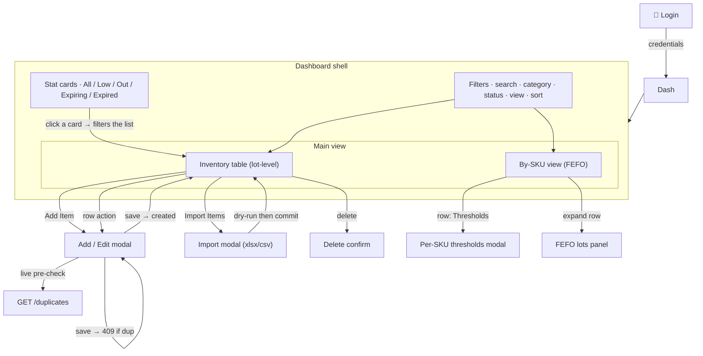

# 06 · UX Design & Page Schematics

> Client-handover pack · [index](../README.md). This is the "click page schematics" — the
> screens, how you move between them, and the design rationale.

## 1. Design principles

1. **Attention-first.** What needs a human to act on is the most visible thing: Out-of-stock
   and Expired are the loudest, Low and Expiring-soon are quieter, Adequate is calm.
2. **Encode state in form, not just number.** A colored pill/chip, not just a date, so a
   reader sees "this needs attention" at a glance.
3. **One source of truth for time.** "Expired" vs "Expiring soon" is computed server-side
   (`date('now')`), so the stat cards, filters, table, and By-SKU view always agree.
4. **Warn early, block authoritatively.** The add form *pre-warns* about duplicates; the
   server still *enforces* it (409) so the guard can't be bypassed.
5. **Two lenses on the same data.** Lot-level table for "what is in the bin"; By-SKU (FEFO)
   for "how much of this product do I have, and which lot do I issue first."

## 2. Design language

- **System:** Tailwind CSS v3 utility classes; `lucide-react` icons.
- **Semantic color (independent of the accent):**
  | Meaning | Color | Used for |
  |---------|-------|----------|
  | Adequate / OK | green | status pill, healthy expiry |
  | Low stock | yellow | status pill |
  | Out of stock | red | status pill |
  | **Expired** | red (chip: "Expired · −Nd") | expiry cell, red "Expired" stat card |
  | **Expiring soon** | amber (`+Nd · expiring soon`) | expiry cell, orange "Expiring soon" card |
  | Action / primary | blue | buttons, links, focus rings |
- **Expiry coloring rule:** `<0` days → red "Expired · −Nd"; `1–30` days → amber; `>30` → green.

## 3. Page-flow schematic



## 4. Wireframes (schematics)

**Login**
```
┌──────────────────────────────┐
│   company name                │
│  ┌──────────────────────────┐ │
│  │ Username                 │ │
│  │ Password                 │ │
│  └──────────────────────────┘ │
│        [ Sign in ]            │
└──────────────────────────────┘
```

**Dashboard shell**
```
┌─────────────────────────────────────────────────────────────┐
│ [stat] All │ Low │ Out │ Expiring soon │ Expired    [+ Add][Import][Export][⚙] │
├─────────────────────────────────────────────────────────────┤
│ Filters:  [search] [category▾] [status▾] [view▾] [sort▾]  Reset │
├─────────────────────────────────────────────────────────────┤
│ main view tabbed:  [ Inventory (lots) ]   [ By-SKU (FEFO) ]  │
│   … table …                                              │
└─────────────────────────────────────────────────────────────┘
```

**Add / Edit modal (with the duplicate warning)**
```
┌──────────────────────────────────┐
│  Add Item                         │
│  SKU [____]  Name [____]         │
│  Qty [__] Unit [pc▾]  Bin [____] │
│  Category [__▾] Specification [__]│
│  Mfg [date]  Expiry [date]        │
│ ┌──────────────────────────────┐ │
│ │ ⚠ 2 similar lots match these │ │
│ │ · A1-02 · exp 2026-11-01 …    │ │
│ │ ☐ Add anyway — I understand   │ │
│ └──────────────────────────────┘ │
│        [ Cancel ]  [ Add Item ]   │
└──────────────────────────────────┘
```

**By-SKU / FEFO (expanded row)**
```
│ SKU / Name        On Hand  Min/Max   Status          Lots  Soonest  │
│ HYD-ISO-VG68     13       4 / 12   ● Expiring      2·2  +20d  │
│  ┌ Issue order — FEFO (soonest expiry first) ─────────────┐ │
│  │ ✔ Issue 1st   5 drum · A1-02 · exp +20d (amber)        │ │
│  │ #2             8 drum · A1-01 · exp +400d (green)      │ │
│  └─────────────────────────────────────────────────────────┘ │
```

## 5. Component inventory

| Component | Role |
|-----------|------|
| `StatsCards` | the five attention tiles (All/Low/Out/Expiring/Expired); a click sets the filter |
| `Filters` | search + category + status + view + sort; category list is driven by **live** categories |
| `InventoryTable` | lot-level rows, pagination, per-row edit/delete/image, expiry coloring |
| `EditModal` | add/edit form; debounced live duplicate pre-check + "add anyway" override |
| `ImportModal` | drag-drop xlsx/csv; client-side parse + preview; commit with skip-duplicates |
| `SkuSummary` | By-SKU FEFO view; expandable lots panel; per-SKU thresholds modal |
| `UploadModal` / image proxy | capture/upload item photos to Tigris |
| `ChangePasswordModal` | self-service password change (HIBP-checked) |
| `SettingsModal` / `AdminPanels` | company name; user, category, unit management |
| `ExportButton` | CSV / XLSX download |
